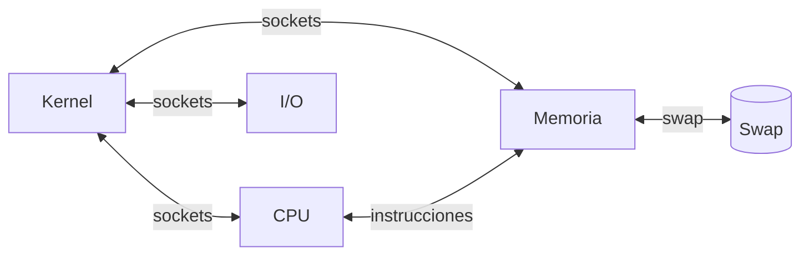
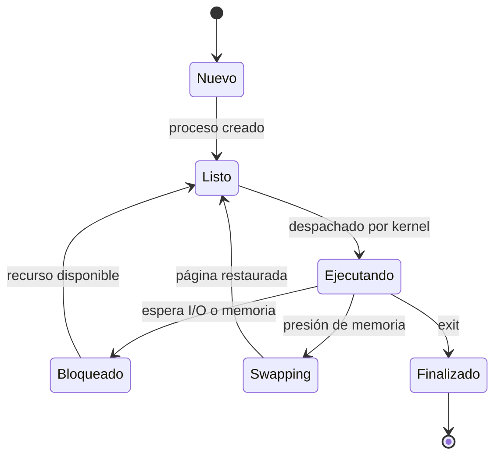

# Los Go-Getters — Trabajo Práctico de Sistemas Operativos


[English](README.md) | [Español](README.es.md)

> Trabajo práctico de **Sistemas Operativos**, UTN FRBA, 2025.
> Hecho con **3 compañeros**.

## Descripción

Un sistema operativo distribuido simplificado escrito en Go. El sistema se divide en módulos independientes que se comunican por sockets:

- **Kernel** — planificación y coordinación de procesos.
- **CPU** — ejecución de instrucciones.
- **Memoria** — paginación, swap y acceso al espacio de usuario.
- **I/O** — manejo de dispositivos e interfaces.
- **Utils** — protocolo compartido y helpers.

## Arquitectura



## Mi aporte: módulo de memoria

Implementé y mantuve el **módulo de memoria**:

- Paginación multinivel y estructuras de tablas de páginas.
- Asignación dinámica de páginas y memoria según configuración.
- Gestión de **swap** y migración de procesos entre memoria y swap.
- **Dump memory** y métricas por proceso.
- Comunicación con Kernel y CPU por sockets.
- Endpoints para leer/escribir espacio de usuario y cargar pseudocódigo.
- Corrección de condiciones de carrera con mutex.



## Estructura

```text
├── kernel/    # scheduler, requests, globals
├── cpu/       # ejecución de instrucciones, configs TLB/cache
├── memoria/   # paginación, swap, dump, endpoints HTTP
├── io/        # módulo de I/O y configs
├── utils/     # protocolo compartido, logging, helpers
├── go.work
└── verificar_concurrencia.sh
```

## Puntos de ingeniería

- Acceso concurrente a estructuras de memoria compartida protegido con mutex.
- Protocolo explícito entre módulos, con handshakes y mensajes tipados.
- Modelo de memoria configurable: paginación, TLB, cache, swap y planificación.
- Entorno local reproducible con múltiples procesos y sockets.
- 15 scripts de prueba de scheduling, I/O, memoria y concurrencia.

## Stack

`Go 1.24` · `Concurrencia` · `Sockets` · `Paginación` · `Swap` · `Mutex` · `Git`

## Cómo ejecutarlo

Cada módulo es un módulo de Go. Desde el directorio de cada módulo:

```bash
go build ./...
go run .
```

Los JSON de `memoria/configuracionmemoria/`, `cpu/CPUconfig/` e `io/IOconfig/` permiten probar distintas configuraciones de memoria y planificación.

## Métricas del proyecto

- **22 commits** míos en el repositorio del equipo.
- **257 commits** totales.
- **15 scripts de prueba** de memoria, I/O y concurrencia.

## Créditos

Hecho con **3 compañeros** para la materia Sistemas Operativos de UTN FRBA.
