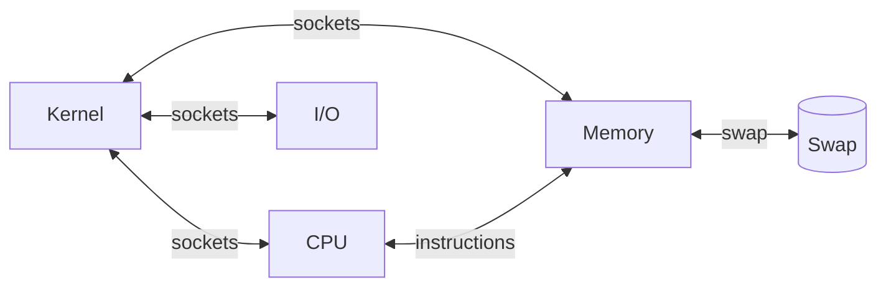

# Los Go-Getters — Operating Systems Project

> Academic project for **Sistemas Operativos**, UTN FRBA, 2025.
> The repository belongs to the course team. This case study documents the architecture and my contribution.

## Overview

A simplified distributed operating system written in Go. The system is split into independent modules that communicate over sockets:

- **Kernel** — process scheduling and coordination.
- **CPU** — instruction execution.
- **Memory** — paging, swap and user-space access.
- **I/O** — device and interface handling.
- **Utils** — shared protocol and helpers.

## My contribution: the memory module

I implemented and maintained the **memory module**:

- Multilevel paging and page-table structures.
- Dynamic page/memory allocation based on configuration.
- **Swap** management and process migration between memory and swap.
- **Dump memory** and process metrics.
- Communication with Kernel and CPU over sockets.
- Endpoints to read/write user space and load pseudocode.
- Race-condition fixes using mutexes.

## Architecture

## Engineering highlights

- Concurrent access to shared memory structures protected with mutexes.
- Explicit protocol between modules, with handshakes and typed messages.
- Configuration-driven memory model.
- Reproducible local environment with multiple processes and sockets.

## Stack

`Go 1.24` · `Concurrency` · `Sockets` · `Paging` · `Swap` · `Mutexes` · `Git`

## Links

- [LinkedIn](https://www.linkedin.com/in/luca-domio-dev)
- [Portfolio](https://github.com/lDomio)
- Code belongs to the UTN course team; available to discuss in interviews.
