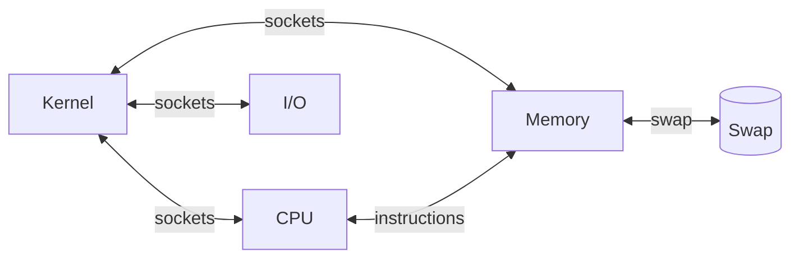
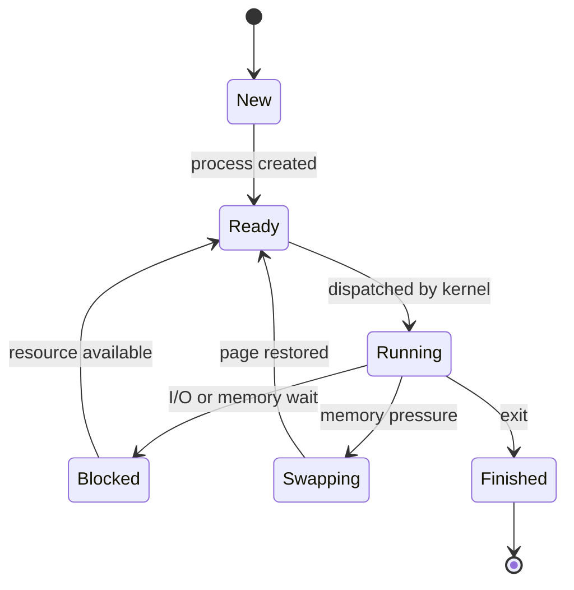

# Los Go-Getters — Operating Systems Project


[English](README.md) | [Español](README.es.md)

> Academic project for **Sistemas Operativos**, UTN FRBA, 2025.
> Built with **3 colleagues**.

## Overview

A simplified distributed operating system written in Go. The system is split into independent modules that communicate over sockets:

- **Kernel** — process scheduling and coordination.
- **CPU** — instruction execution.
- **Memory** — paging, swap and user-space access.
- **I/O** — device and interface handling.
- **Utils** — shared protocol and helpers.

## Architecture



## My contribution: the memory module

I implemented and maintained the **memory module**:

- Multilevel paging and page-table structures.
- Dynamic page/memory allocation based on configuration.
- **Swap** management and process migration between memory and swap.
- **Dump memory** and process metrics.
- Communication with Kernel and CPU over sockets.
- Endpoints to read/write user space and load pseudocode.
- Race-condition fixes using mutexes.



## Repository layout

```text
├── kernel/    # scheduler, requests, globals
├── cpu/       # instruction execution, TLB/cache configs
├── memoria/   # paging, swap, dump, HTTP endpoints
├── io/        # I/O module and configs
├── utils/     # shared protocol, logging, safe helpers
├── go.work
└── verificar_concurrencia.sh
```

## Engineering highlights

- Concurrent access to shared memory structures protected with mutexes.
- Explicit protocol between modules, with handshakes and typed messages.
- Configuration-driven memory model: paging, TLB, cache, swap and scheduling.
- Reproducible local environment with multiple processes and sockets.
- 15 test scripts covering scheduling, I/O, memory and concurrency.

## Stack

`Go 1.24` · `Concurrency` · `Sockets` · `Paging` · `Swap` · `Mutexes` · `Git`

## Running

Each module is a Go module. From a module directory:

```bash
go build ./...
go run .
```

Use the JSON files under `memoria/configuracionmemoria/`, `cpu/CPUconfig/` and `io/IOconfig/` to try different memory and scheduling configurations.

## Project metrics

- **22 commits** by me in the team repository.
- **257 commits** total.
- **15 test scripts** for memory, I/O and concurrency.

## Credits

Built with **3 colleagues** for the Operating Systems course at UTN FRBA.
